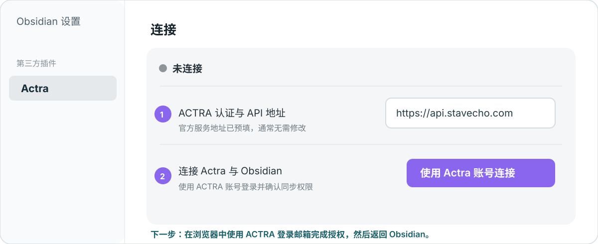
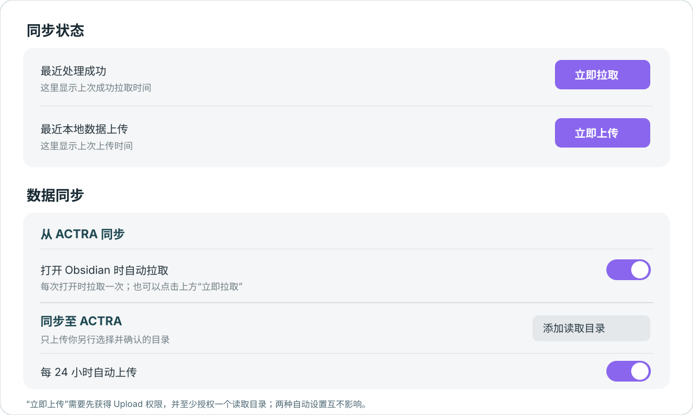

# Actra 插件使用指南

用 Actra 插件把 ACTRA 的日常记录、笔记和录音内容同步到 Obsidian。需要让 ACTRA 使用本地笔记时，再单独授权要上传的目录。

> 以下图片是操作示意。桌面端、iOS 和 Android 的界面可能略有不同；连接和同步都从 **Obsidian 的 Actra 插件设置**操作。

## 1. 安装 Actra

在 Obsidian 中打开要连接的知识库，进入 **设置 → 第三方插件 → 浏览**，搜索 **Actra**，点击 **安装**、**启用**。然后在设置左侧选择 **Actra**。

如果社区插件市场暂时搜不到 Actra，可按文末的[手动安装方法](#手动安装)操作。

## 2. 连接 ACTRA 账号

1. 官方服务保留预填地址 `https://api.stavecho.com`，无需修改。
2. 点击 **使用 Actra 账号连接**。在打开的浏览器页面，用**登录 ACTRA 的邮箱**完成验证码和授权。
3. 允许浏览器返回 Obsidian。插件显示 **已连接**，即连接完成。

授权页中的 **Daily Log、Note、Recording** 用于把 ACTRA 数据同步到 Obsidian；**Upload** 用于把你另行选择的 Obsidian 笔记同步至 ACTRA。授权 Upload 后也不会自动读取整个知识库。

## 3. 获取 ACTRA 内容

在 **同步状态** 点击 **立即拉取**。插件默认也会在打开 Obsidian 后拉取一次，开关位于 **数据同步 → 从 ACTRA 同步**。

内容写入当前知识库的 `ACTRA` 目录，并带有 `actra-synced` 标签。再次拉取同一条记录不会重复创建文件。Obsidian 关闭时不会执行拉取。

## 4. 可选：上传本地笔记

在 **数据同步 → 同步至 ACTRA** 点击 **添加读取目录**，选择文件夹，并在弹窗中确认授权。插件只读取该文件夹及其子文件夹中的 Markdown；笔记链接不会扩大读取范围，ACTRA 同步生成的文件也会被过滤。

授权后可在 **同步状态** 点击 **立即上传**。**每 24 小时自动上传**默认开启，可独立关闭；手动上传始终可用。自动上传只在 Obsidian 运行时检查。若不再允许上传某个目录，在目录右侧点击 **移除**。

## 遇到问题

- **上传按钮不可用**：检查是否已连接、授权了 Upload、添加了读取目录，以及同步是否已暂停。
- **授权后没有返回 Obsidian**：打开原知识库查看连接状态；如仍未连接，重新点击连接按钮，并允许浏览器打开 `obsidian://` 链接。
- **手机锁屏后没有自动上传**：移动系统可能暂停 Obsidian；重新打开后再检查，或点击 **立即上传**。
- **想换 ACTRA 服务地址**：在 **连接** 中点击 **更改**。保存新地址后需重新登录授权。

### 手动安装

从 [Actra GitHub Release](https://github.com/stavecho/actra-obsidian/releases/latest) 下载**同一版本**的 `main.js`、`manifest.json`、`styles.css`，放入知识库的 `.obsidian/plugins/actra-connect/`，重启 Obsidian 后在 **设置 → 第三方插件** 中启用 Actra。

数据处理范围见[隐私政策](../PRIVACY.md)。
