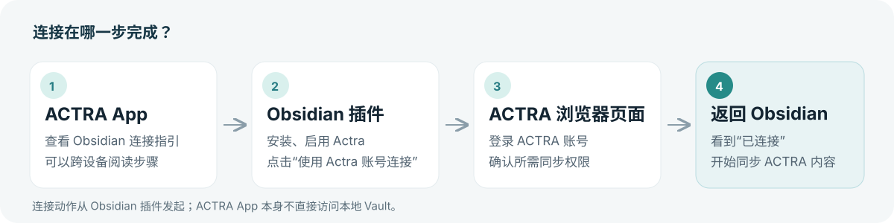

# 在 Obsidian 中使用 Actra

把 ACTRA 的每日记录、笔记和录音内容同步到 Obsidian；如果你希望 ACTRA 使用自己的 Obsidian 笔记，再单独选择允许上传的目录。

> **先记住两件事**：连接要从 **Obsidian 的 Actra 插件设置**发起；连接账号后，插件**不会默认读取整个知识库**。

本指南适用于桌面端、iOS 和 Android 的 Obsidian 1.13.0 及以上版本。图中的设置卡片是操作示意，实际外观会随设备和 Obsidian 主题略有不同。

## 1. 安装并打开插件

1. 打开 Obsidian，先进入你想连接的知识库（Vault）。
2. 打开 **设置 → 第三方插件**。如果启用了受限模式，按页面提示关闭。
3. 点击 **浏览**，搜索 **Actra**，依次点击 **安装**、**启用**。
4. 返回设置页，在左侧 **第三方插件** 下点击 **Actra**。

> 如果社区插件市场暂时搜不到 Actra，可能是上架审核尚未完成。测试用户可按文末的[手动安装方法](#测试用户手动安装)使用 GitHub Release。

## 2. 用 ACTRA 账号连接

1. 在 **连接** 区域确认“ACTRA 认证与 API 地址”。使用官方 ACTRA 服务时，保留默认的 `https://api.stavecho.com` 即可；只有使用指定的其他 ACTRA 服务时才需要修改。
2. 点击 **使用 Actra 账号连接**。浏览器会打开 ACTRA 授权页。
3. 使用**登录 ACTRA 的邮箱**获取验证码，按页面提示完成图形验证码和邮箱验证码，并确认同步权限。这里不需要填写 Obsidian 账号邮箱。
4. 授权完成后，允许浏览器返回 Obsidian。插件显示 **已连接** 后，会进行首次数据拉取。

如果 ACTRA App 和 Obsidian 在不同设备上，也请在**安装了 Obsidian 的设备**上完成第 2～4 步。ACTRA App 可以帮助你了解连接步骤，但不能代替插件读取或写入本地知识库。

### 授权页上的四类权限

| 权限 | 数据方向 | 作用 |
| --- | --- | --- |
| Daily Log | ACTRA → Obsidian | 同步 ACTRA 的日常记录 |
| Note | ACTRA → Obsidian | 同步 ACTRA 的笔记和灵感 |
| Recording | ACTRA → Obsidian | 同步 ACTRA 的录音记录、摘要和转写 |
| Upload | Obsidian → ACTRA | 允许插件上传你**另行选择并确认**的本地 Markdown 目录 |

勾选 **Upload** 也不会立刻开放整个 Vault。想使用本地笔记上传，还需要完成第 4 步的目录授权。

## 3. 把 ACTRA 内容同步到 Obsidian

连接成功后，在 **同步状态** 点击 **立即拉取**，即可手动获取最新内容。插件默认还会在每次打开 Obsidian、界面准备好后拉取一次；这个开关位于 **数据同步 → 从 ACTRA 同步**。

同步得到的 Markdown 会保存在当前 Vault 的 `ACTRA` 目录中。你可以像普通笔记一样阅读和搜索它们。插件会给这些文件加上 `actra-synced` 标签，避免它们又被上传回 ACTRA。重复拉取同一条记录不会再创建一份相同的笔记。

> Obsidian 关闭时，插件无法写入本地文件。下次打开 Obsidian 后可等待自动拉取，或点击 **立即拉取**。

## 4. 可选：让 ACTRA 使用指定的 Obsidian 笔记

只有需要把自己的 Obsidian Markdown 同步至 ACTRA 时，才需要这一步。

1. 在 **数据同步 → 同步至 ACTRA** 点击 **添加读取目录**。
2. 选择要上传的文件夹，阅读弹出的用途和文件数量说明，再点击 **授权此目录**。所选文件夹及其子文件夹会进入读取范围；笔记中的链接不会把范围扩大到其他目录。
3. 授权后，如果自动上传已开启，插件会执行一次上传。你也可以在 **同步状态** 点击 **立即上传**。
4. **每 24 小时自动上传**默认开启，可以关闭；关闭后 **立即上传**仍可单独使用。自动上传只会在 Obsidian 运行时检查。

不再希望上传某个文件夹时，点击该目录右侧的 **移除**。这会停止以后对该目录的读取和上传；已经上传到 ACTRA 的副本不会因此自动删除。ACTRA 同步生成的文件会被过滤，不会通过这条路径回传。

## 5. 日常查看与管理

| 想做什么 | 在哪里操作 |
| --- | --- |
| 获取 ACTRA 最新内容 | **设置 → Actra → 同步状态 → 立即拉取** |
| 上传已授权目录的本地笔记 | **设置 → Actra → 同步状态 → 立即上传** |
| 查看最近同步时间 | **设置 → Actra → 同步状态** |
| 关闭打开 Obsidian 时自动拉取 | **数据同步 → 从 ACTRA 同步** |
| 关闭每 24 小时自动上传 | **数据同步 → 同步至 ACTRA** |
| 暂时停止同步 | **连接 → 暂停同步**；以后可点击 **恢复同步** |
| 更换 ACTRA 服务地址 | 已连接时在 **连接** 点击 **更改**；保存新地址后需要重新登录授权 |
| 解除账号连接 | **连接 → 解除连接**；本地已经同步的 Markdown 会保留 |

## 常见问题

**为什么“立即上传”不能点？** 先确认插件显示“已连接”、ACTRA 授权包含 Upload、已添加并确认至少一个读取目录，且同步没有暂停。

**授权完成后没有回到 Obsidian？** 手动打开原来的 Obsidian Vault，检查 **设置 → Actra** 是否显示“已连接”。如仍未连接，在插件里重新点击连接按钮，并允许浏览器打开 `obsidian://` 链接。

**手机锁屏后还会每 24 小时上传吗？** 移动系统可能暂停后台应用。自动上传只在 Obsidian 运行时执行；重新打开后插件会检查是否到了执行时间。你也可以手动点击“立即上传”。

**出现冲突文件怎么办？** 当原笔记中由 ACTRA 管理的内容被改动、无法安全覆盖时，插件会保留原文件并生成带 `.conflict-` 的副本。先比较两份内容，再决定保留哪一份；插件不会替你删除文件。

**解除连接会删除笔记吗？** 不会。解除连接会停止后续同步并清除插件本地登录凭据，已写入 Obsidian 的 Markdown 保留。

### 测试用户手动安装

在插件尚未上架社区市场时，从 [Actra GitHub Release](https://github.com/stavecho/actra-obsidian/releases/latest) 下载同一版本的 `main.js`、`manifest.json`、`styles.css`，放入当前 Vault 的 `.obsidian/plugins/actra-connect/`，然后重启 Obsidian，在 **设置 → 第三方插件** 中启用 Actra。正式上架后，优先通过社区插件市场安装和更新。

如需了解数据范围与保存方式，请阅读[隐私政策](../PRIVACY.md)。
